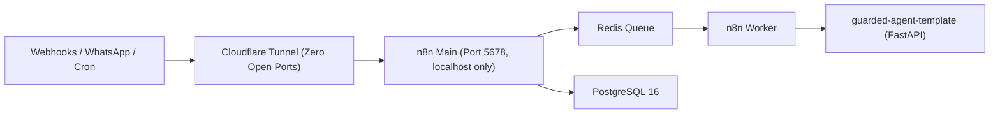

# pi-n8n-ai-stack

[](https://github.com/moutaz121493/pi-n8n-ai-stack/actions/workflows/ci.yml)
[](https://www.raspberrypi.com/)
[](LICENSE)

Hardened, **ARM64-ready n8n infrastructure template** designed for Raspberry Pi 5 and small self-hosted servers, bundled with CI-validated agentic workflow JSON exports.

Part of a 3-repo self-hosted AI stack alongside [`guarded-agent-template`](https://github.com/moutaz121493/guarded-agent-template) and [`whatsapp-agent-kit`](https://github.com/moutaz121493/whatsapp-agent-kit).

## Architecture



## Two Deployment Profiles

| Profile | File | Backend | Memory Budget | Best For |
| :--- | :--- | :--- | :--- | :--- |
| **Production Queue Mode** | `docker-compose.yml` | PostgreSQL 16 + Redis 7 + Worker | ~1.2 GB | 8 GB Pi 5 / VPS / multi-workflow concurrency |
| **Lightweight 4 GB Pi 5** | `docker-compose.pi4g.yml` | SQLite (WAL + startup vacuum) | ~384 MB cap | 4 GB Pi 5 shared with other homelab containers |

## 5-Minute Quickstart

```bash
git clone https://github.com/moutaz121493/pi-n8n-ai-stack.git
cd pi-n8n-ai-stack
cp .env.example .env
# Edit .env and set N8N_ENCRYPTION_KEY (openssl rand -hex 32) and POSTGRES_PASSWORD

# Option A: Lightweight 4 GB Raspberry Pi 5 profile
docker compose -f docker-compose.pi4g.yml up -d

# Option B: Production Queue Mode (Postgres + Redis + Worker)
docker compose up -d

# Optional: Enable zero-trust Cloudflare Tunnel ingress
docker compose --profile tunnel up -d
```

## Included Workflow Templates (`workflows/`)

| File | Purpose |
| :--- | :--- |
| `01-ai-webhook-triage.json` | Webhook intake → Guarded Agent classification → branches into auto-resolve (`200`) vs. human approval (`202`). |
| `02-budget-guarded-agent-bridge.json` | Preflight `/healthz` budget check before calling the LLM agent; returns deterministic `429` fallback if cap is reached. |
| `03-daily-ops-brief.json` | Scheduled 07:00 homelab health summary pushed to `ntfy` or any webhook target. |

All templates are validated in CI via `python3 scripts/validate_workflows.py` for valid n8n schema, `active: false` export safety, and zero leaked secrets or private IPs.

## Hardening Defaults

- **Loopback-only binding (`127.0.0.1:5678`)** — never exposes n8n directly to LAN/WAN; pair with Cloudflare Tunnel or Tailscale.
- **Telemetry disabled** — diagnostics, version pings, and personalization turned off.
- **Env isolation** — `N8N_BLOCK_ENV_ACCESS_IN_NODE=true` prevents untrusted workflow expressions from reading container secrets.
- **Execution pruning** — caps database growth on SD/NVMe storage (`EXECUTIONS_DATA_MAX_AGE`).
- **Explicit memory caps** — prevents OOM kills on small ARM64 boards.

See [SECURITY.md](SECURITY.md) for the threat model and deployment checklist.
